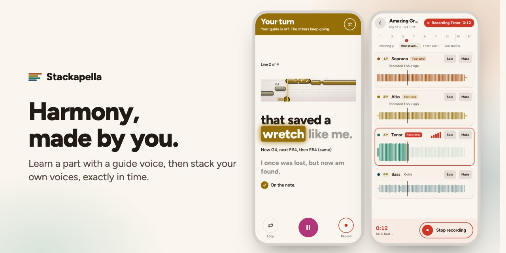
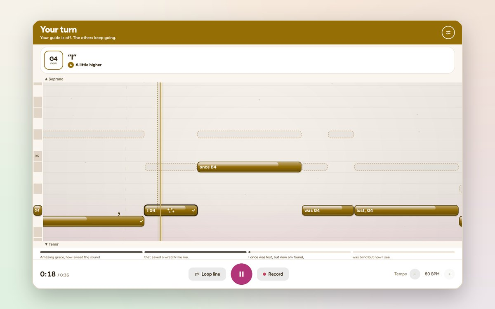
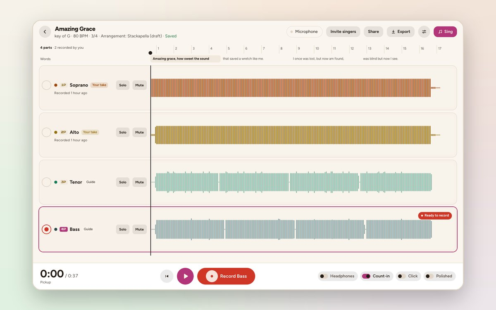
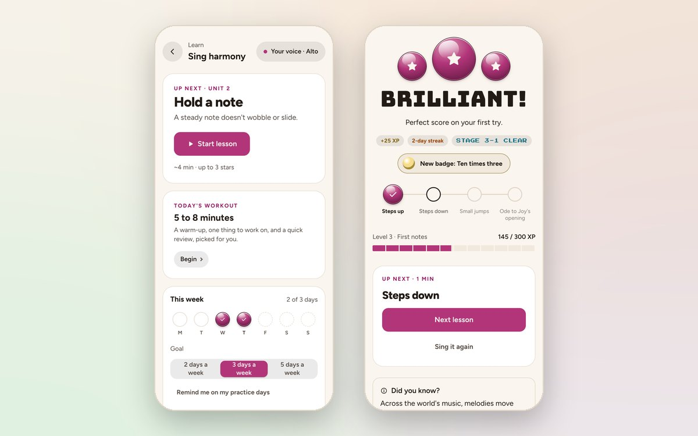
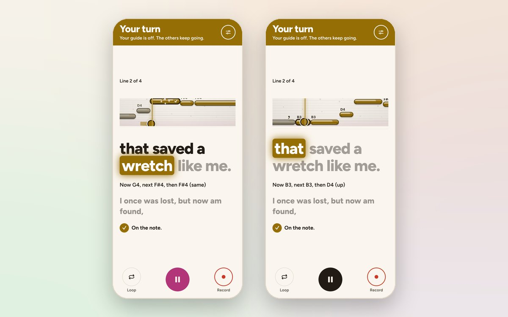

<picture>
  <source media="(prefers-color-scheme: dark)" srcset="web/icons/readme/banner-dark.jpg">
  
</picture>

# Stackapella

Stackapella is a web app for singing harmony on your own. You learn a part with a guide voice, then
record every part of a song yourself, one voice at a time, and hear them come together. Try it at
[stackapella.com](https://stackapella.com/?ref=github).

<table>
<tr>
<td width="50%">
<picture>
  <source media="(prefers-color-scheme: dark)" srcset="web/icons/readme/sing-dark.jpg">
  
</picture>

<b>Your notes light up as you hit them</b>

</td>
<td width="50%">
<picture>
  <source media="(prefers-color-scheme: dark)" srcset="web/icons/readme/studio-dark.jpg">
  
</picture>

<b>Record every part, exactly in time</b>

</td>
</tr>
<tr>
<td width="50%">
<picture>
  <source media="(prefers-color-scheme: dark)" srcset="web/icons/readme/course-dark.jpg">
  
</picture>

<b>A free course to four-part harmony</b>

</td>
<td width="50%">
<picture>
  <source media="(prefers-color-scheme: dark)" srcset="web/icons/readme/looks-dark.jpg">
  
</picture>

<b>Two looks: a game, or a calm practice tool</b>

</td>
</tr>
</table>

- Learn a part by ear from a guide voice, then sing it on your own while the other parts play.
- Record each part over the ones before, lined up exactly in time, and share the whole song.
- A free course from your first note to four-part harmony, and short courses on skills and styles.
- Practice tracks and choir groups for choirs.
- Two looks: a game with stars and combos, or a plain practice tool.

The server is Laravel and MySQL. The app is Vue loaded from a CDN, with no npm and no build step.
Recording uses Web Audio and an AudioWorklet, with every part scheduled on the audio clock, and your
pitch is tracked on your device.

## Running it

To run your own copy, start at [stackapella.com/selfhost](https://stackapella.com/selfhost).
[DEVELOPING.md](DEVELOPING.md) has the full setup, for an install or for working on the code.

## Licence

The code is under the Attribution Assurance License ([LICENSE](LICENSE)). The songs, courses,
guides, help and screenshots are under CC BY-SA 4.0 ([CONTENT-LICENSE](CONTENT-LICENSE)). The
Stackapella name and logo are covered by neither: see [TRADEMARK.md](TRADEMARK.md). More at
[stackapella.com/open-source](https://stackapella.com/open-source).

## Contributing

See [CONTRIBUTING.md](CONTRIBUTING.md). To report a security problem, see [SECURITY.md](SECURITY.md).
